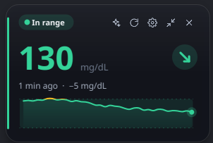
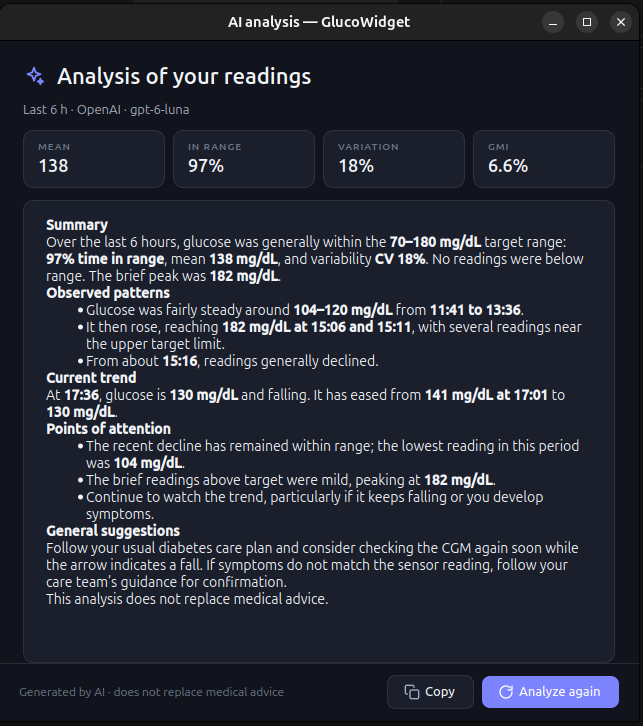

# GlucoWidget

[](https://github.com/94rodrigo/glucose-monitor-pc-widget/actions/workflows/ci.yml)

A small always-visible desktop widget (Windows and Linux) that shows your **FreeStyle Libre** glucose in real time, using the **LibreLinkUp** sharing service. It can also send your recent readings to an AI model of your choice (OpenAI, Claude, Gemini, …) and show you a written analysis.

<p align="center">
  
</p>

> ⚠️ **Not a medical device.** GlucoWidget is an independent open-source project and is not affiliated with Abbott. Never make treatment decisions based on it alone: always confirm on your official reader or app, and talk to your healthcare team.

## Contents

- [How it works](#how-it-works)
- [Features](#features)
- [Getting started](#getting-started)
- [Using the widget](#using-the-widget)
- [Settings](#settings)
- [AI analysis](#ai-analysis-optional)
- [Privacy and where your data lives](#privacy-and-where-your-data-lives)
- [Troubleshooting](#troubleshooting)
- [Development](#development)

## How it works

```
FreeStyle Libre sensor ─► LibreLink app (patient's phone) ─► LibreView cloud ─► LibreLinkUp ─► GlucoWidget
```

LibreView has no public API for personal use. The only way to read your data from a computer is the same mechanism the **LibreLinkUp** app uses: the patient *shares* their data with a "follower" account, and GlucoWidget signs in as that follower (using the same, unofficial, API as the LibreLinkUp app) and polls for new readings every minute.

This means you need:

1. A sensor and the **LibreLink** app on the patient's phone, uploading to LibreView (for example FreeStyle Libre 2 or 3).
2. A **LibreLinkUp** (follower) account that the patient has invited. It must be an account of its own, not the patient's LibreLink login. To follow your own data, invite a second email address.

## Features

- **Always-visible widget:** frameless, draggable, translucent, optionally always on top. Light and dark themes (follows your system).
- **At a glance:** large value, trend arrow, how long ago the reading was taken, change since the previous reading, and a chart of the last 3, 6 or 12 hours with your target range.
- **Meaningful colors, never color alone:** *Very low / Low / In range / High / Very high / Outdated* are always written out next to the color.
- **Compact mode:** shrink it to just the number and arrow (double-click, or the compact button).
- **System tray:** the tray icon shows the current value in the status color; the menu has everything you need.
- **Notifications** when your glucose leaves the target range (optional).
- **mg/dL (default) or mmol/L**, and **English (default) or Portuguese (Brazil)**.
- **Optional AI analysis** with your own API key: summary, patterns, current trend, and points of attention, plus local metrics (mean, time in range, variation, GMI) that work without any AI.
- **Private by design:** your password and API keys are stored in the system keyring (Windows Credential Manager / Secret Service), not in plain files.
- **First-run assistant** and a **demo mode** to try it without an account.

<p align="center">
  
</p>

## Getting started

### 1. Prepare your LibreLinkUp account

1. Install the **LibreLinkUp** app on your phone and create an account.
2. In the patient's **LibreLink** app, go to *Share → Connect LibreLinkUp app* and invite the email of that account.
3. Open LibreLinkUp, accept the invitation and finish the terms of use. (Skipping this step is the most common reason for login errors.)

### 2. Install GlucoWidget

**Option A: download a ready-made build.** Every push builds executables for Windows and Linux. Open the [latest run of the CI workflow](https://github.com/94rodrigo/glucose-monitor-pc-widget/actions/workflows/ci.yml), scroll to **Artifacts** and download `GlucoWidget-windows` or `GlucoWidget-linux` (you need to be signed in to GitHub). There is no installer: unzip the download and run `GlucoWidget.exe` (Windows) or `GlucoWidget` (Linux; make it executable first with `chmod +x GlucoWidget`).

**Option B: run from source.** Requires Python 3.11+.

```bash
git clone https://github.com/94rodrigo/glucose-monitor-pc-widget.git
cd glucose-monitor-pc-widget
python3 -m venv .venv
```

```bash
.venv/bin/pip install -e .
```

```bash
.venv/bin/glucowidget
```

On Windows use `.venv\Scripts\pip` and `.venv\Scripts\glucowidget`.

**Linux prerequisites**

- Qt needs the `libxcb-cursor0` package: `sudo apt install libxcb-cursor0` (Debian/Ubuntu).
- The tray icon on GNOME needs the *AppIndicator* extension (already included in Ubuntu).

### 3. First run

A three-step assistant opens the first time:

1. **Account:** enter your LibreLinkUp email and password and press **Test connection**. It tells you how many patients it found; pick one if there are several.
2. **Glucose:** choose mg/dL or mmol/L and your target range (default 70–180 mg/dL).
3. **AI (optional):** add an API key now or skip it and do it later.

The **EN / PT** switch at the top of the assistant changes the language. Want to look around first? Choose **Explore in demo mode** on the first screen.

You only need to do this once. Your email is saved in the settings file and your password in the system keyring, so the widget signs in by itself on every launch.

## Using the widget

| Action | How |
| --- | --- |
| Move it | Drag it anywhere. The position is remembered. |
| Show the buttons | Hover over the widget. |
| Refresh now | Refresh button (or *Refresh now* in the tray menu). |
| Analyze with AI | Sparkles button (only when an AI provider is set up). |
| Compact mode | Double-click, or the compact button. In compact mode, hover to reveal **expand** and **close** buttons. |
| Hide it | **✕**. It keeps running in the tray; click the tray icon to bring it back. |
| Quit | Tray menu → **Quit** (or **Ctrl+C** in the terminal). |
| Chart details | Hover over the chart to see each reading's value and time. |

**Reading the widget**

- The big number and the arrow (↓↓ ↘ → ↗ ↑↑) are colored by status: red for low, green for in range, amber for high, gray for outdated.
- *Outdated* means the latest reading is more than 15 minutes old (the phone or sensor is not syncing). The widget keeps showing the last value in gray instead of pretending it is current.
- If your connection drops, the widget keeps the last reading, shows *Offline*, and retries with an increasing delay.

The tray menu lets you hide/show the widget, refresh, open the AI analysis, switch compact mode, toggle *Always on top*, change the unit, open Settings, and quit.

## Settings

Open them from the gear button or the tray menu.

| Page | What you can change |
| --- | --- |
| **Account** | LibreLinkUp email/password, **Test connection**, which patient to follow, region, refresh interval (30–900 s, default 60), API version. |
| **Glucose** | Unit (mg/dL or mmol/L), target range, "very low" and "very high" thresholds, and how long until a reading counts as outdated. A preview bar shows your ranges. Defaults follow the international consensus: target 70–180 mg/dL, urgent below 54 and above 250. |
| **Appearance** | Language, theme (system / dark / light), size (80–150 %), opacity, chart length (3 / 6 / 12 h), keep above other windows, hide from the taskbar, reduce animations, start with the system. |
| **Alerts** | Notifications when you leave the target range, with an option for only very low / very high values. The widget does **not** replace the alarms of your sensor or the LibreLink app. |
| **AI** | Provider, model, API key, base URL, analysis period, and optional automatic analyses. |
| **About** | Version and the medical notice. |

## AI analysis (optional)

GlucoWidget can send your recent readings to an AI model and show a written analysis (the window in the screenshot above). It uses **your own API key**, so you pay your provider directly, and nothing is sent until you ask for an analysis (or turn on automatic analysis).

**Set it up:** Settings → **AI**, pick a provider, paste the API key (the page links to where you can create one), optionally change the model, and save. Then use the sparkles button on the widget or **Analyze with AI…** in the tray menu.

| Provider | Default model | Notes |
| --- | --- | --- |
| OpenAI | `gpt-6-luna` | |
| Anthropic Claude | `claude-sonnet-5-5` | |
| Google Gemini | `gemini-2.5-flash` | |
| OpenRouter | `openai/gpt-4o-mini` | One key for many models |
| Groq | `llama-3.3-70b-versatile` | |
| DeepSeek | `deepseek-chat` | |
| Mistral | `mistral-small-latest` | |
| Ollama (local) | `llama3.1` | No key needed; data never leaves your computer |
| Other (OpenAI-compatible) | your choice | Any server that speaks the OpenAI chat API; set the base URL |

Model names change often: the model field is editable, so type any model your provider offers.

**What you get:** the window shows four local metrics (mean, time in range, variation, GMI) and then a written analysis in the interface language: summary, observed patterns, current trend, points of attention and general suggestions. The AI is instructed never to suggest insulin or medication doses. **Analyze again** repeats it, **Copy** copies the text.

**What is sent:** the unit, your target range, the current reading and trend, the summary metrics, and the readings of the chosen period (3, 6, 12 or 24 hours; at most about 160 points). Your name, email and password are never included.

**Automatic analysis** (every 1, 3 or 6 hours) is off by default so it never spends tokens without you knowing. When one finishes while the window is closed, you get a notification; click it to read it.

## Privacy and where your data lives

- **Network connections:** only to LibreLinkUp (`api.libreview.io`, or the regional `api-<region>.libreview.io`) to read your glucose, and to the AI provider you configured when you request an analysis. No telemetry, no analytics, no other servers.
- **Settings** (email, unit, ranges, window position…):
  - Linux: `~/.config/glucowidget/settings.json`
  - Windows: `%LOCALAPPDATA%\glucowidget\settings.json`
- **Secrets** (LibreLinkUp password and API keys) go to the system keyring. If no keyring is available (for example a Linux session without one), they fall back to `secrets.json` in the same folder (permissions `600`) and a warning is logged.
- **To forget everything:** clear the fields in *Settings → Account* and *Settings → AI* and save, then delete the settings folder.

## Troubleshooting

| Symptom | What to do |
| --- | --- |
| *Couldn't sign in: incorrect email or password* | Use the credentials of the account you created in the **LibreLinkUp** app. |
| *Action needed in LibreLinkUp* | Open the LibreLinkUp app on your phone, sign in with this account and accept the terms or verification it asks for. |
| *No patient connected* | In the patient's LibreLink app: *Share → Connect LibreLinkUp app*, invite your follower email, and accept the invitation. |
| Login suddenly fails after it worked | LibreLinkUp may reject old client versions. Raise **API version** in *Settings → Account* (default `4.16.0`) to the current LibreLinkUp app version. |
| The value shows as *Outdated* | The patient's phone or sensor has not uploaded for more than 15 minutes. Check the LibreLink app. |
| *No connection* | The widget retries automatically with a growing delay (up to 10 minutes). Use **Try now** to retry immediately. |
| AI error: invalid key / usage limit / model not found | Check the key, your provider credits, and the model name. |
| Linux: `Could not load the Qt platform plugin "xcb"` | `sudo apt install libxcb-cursor0` |
| Linux Wayland: the widget does not stay on top, or opacity has no effect | Wayland does not let apps do this. Installing `libxcb-cursor0` makes the app run through XWayland, where both work. |
| No tray icon on GNOME | Enable the *AppIndicator* extension. |
| Try the interface without an account | `glucowidget --demo` (see the options below). |

## Development

```bash
.venv/bin/pip install -e . pytest
```

```bash
.venv/bin/python -m pytest
```

Command-line options (mostly for development):

- `--demo [normal|low|high|stale|offline|auth|nopatient]`: synthetic data, no account needed
- `--onboarding`: reopen the setup assistant
- `--debug`: verbose logging
- `--selftest REPORT`: verify an installed or packaged build and write a report (exit code 0 = OK)

**Build an executable.** PyInstaller cannot cross-compile, so build on the target system (on Linux it also needs `binutils`):

```bash
.venv/bin/pip install pyinstaller
```

```bash
.venv/bin/pyinstaller packaging/glucowidget.spec
```

The result is `dist/GlucoWidget` (Linux) or `dist\GlucoWidget.exe` (Windows). Check it with `dist/GlucoWidget --selftest report.txt`.

**Continuous integration.** `.github/workflows/ci.yml` runs the tests on Linux and Windows for every push and pull request, builds the executable on both systems, runs `--selftest` on it (on Windows it also checks that the Credential Manager backend is the one in use) and uploads the builds as artifacts.

**Project layout**

```
src/glucowidget/
  app.py            controller: polling, tray, alerts, AI, dialogs
  config.py         settings (JSON) and secrets (keyring)
  libre/            LibreLinkUp client and data models
  sources.py        real data source and demo source
  status.py         low / in range / high classification
  units.py          mg/dL <-> mmol/L conversion and formatting
  metrics.py        CGM metrics (time in range, variation, GMI)
  ai/               AI providers (plain REST) and prompt building
  i18n.py, locales/ translations: English source strings, catalog in locales/pt.py
  ui/               widget, chart, components, dialogs, title bar, theme (design tokens)
  selftest.py       checks used by --selftest and CI
tests/              pytest suite (logic, AI providers, dialogs, widget, translations)
packaging/          PyInstaller spec and icon generator
```

**Translations.** Strings in the code are written in English and wrapped in `tr("...")` (or `N_("...")` for constants). To add or change a language, edit `src/glucowidget/locales/pt.py`; `tests/test_i18n.py` fails if a string has no translation or the placeholders do not match.

**Font.** The interface uses *Inter* if it is installed or if you put its `.ttf` files in `src/glucowidget/assets/fonts/` (OFL license). Otherwise it falls back to Segoe UI (Windows) or the system font.
